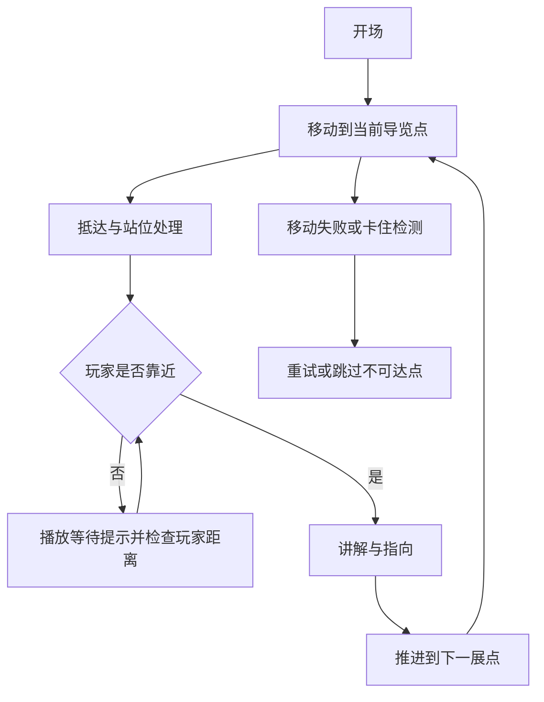
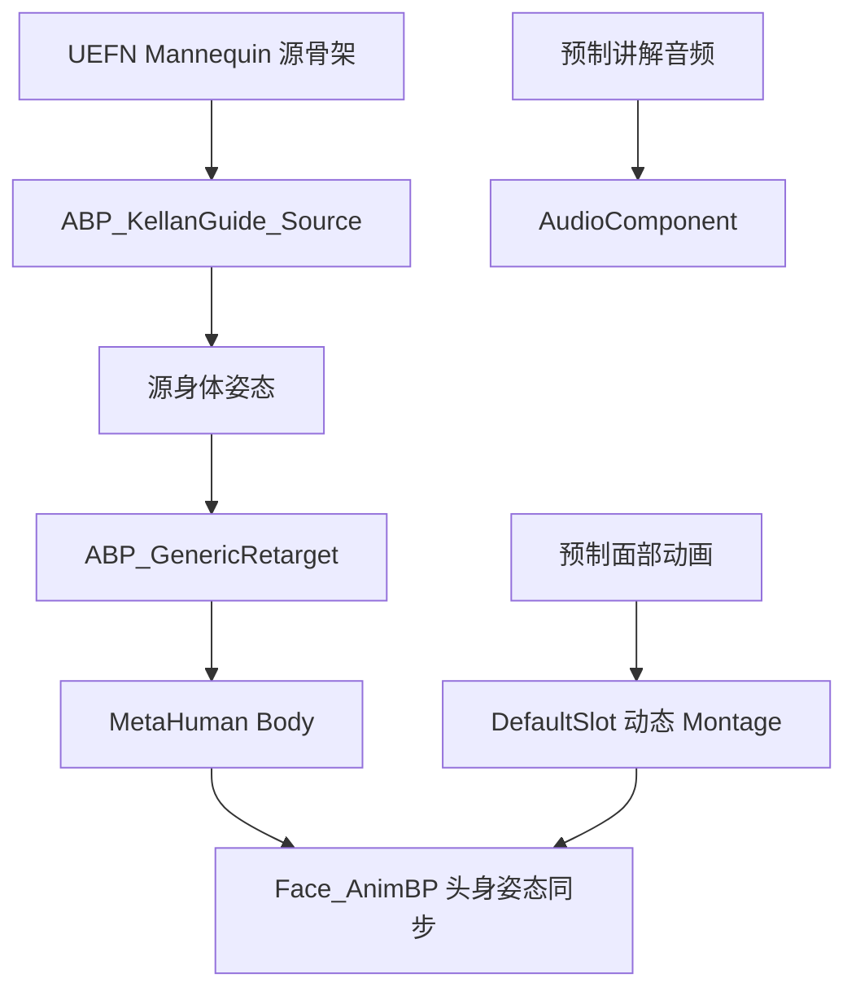
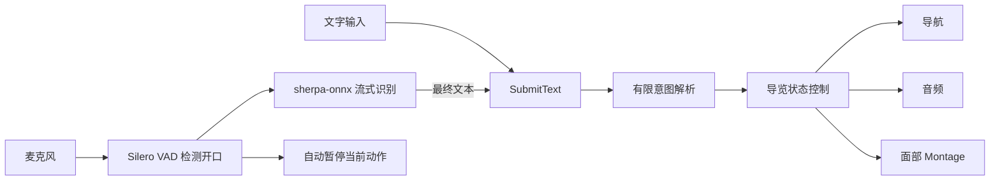

# 数字人导览 Demo：项目介绍与 STAR 面试稿

> 基于 VRTemplateMap5 的工程分析整理，更新日期：2026 年 11 月 3 日。
>
> 依据：项目源码、编辑器资产检查快照、迁移脚本和历史验证报告。本次未重新运行编辑器或关卡。下文第一人称内容为面试表达草稿，请按本人实际负责范围使用。

## 1. 项目概述

本项目以 Unreal Engine 5.8 为基础，围绕 VR 场景中的 MetaHuman 数字人导览，整合角色导航、玩家等待、展品讲解、身体手势与面部动画，形成多展点导览 Demo。

技术探索集中在三个方向：

1. **MCP 辅助动画管线维护**：读取蓝图与资产信息，定位动画重定向及执行连线问题，通过工具修改、编译和验证。
2. **动画资产复用与局部修复**：将源骨架动作适配到数字人，并通过脚本修复跨骨架手势及指向动作的收手过渡。
3. **可打断导览交互实验**：在独立实验关卡中，接入文字和本地流式语音，探索暂停、继续、重讲及展点切换。

一句话介绍：

> 这是一个基于 UE 5.8 的数字人导览 Demo。我围绕动画复用、MCP 辅助编辑器工作流和可打断交互进行了技术探索，并通过编译检查、姿态比较与 PIE 验证建立了结果反馈链路。

## 2. 功能范围与当前状态

| 范围 | 主要能力 | 状态说明 |
| --- | --- | --- |
| VRTemplateMap5 基础导览 | 多展点移动、等待玩家、讲解、指向、自动推进 | 资产检查快照中存在对应角色、目标点及蓝图事件 |
| 动画重定向迁移 | 曲线驱动的重定向参数覆盖、蓝图函数迁移 | 存在 C++ 实现、迁移成功报告与历史 PIE 日志检查结果 |
| 手势和收手修复 | 局部手指修复、手臂向 Idle 平滑过渡 | 存在生成脚本、姿态比较报告及蓝图引用检查快照 |
| GuideIntentLab 实验 | 文字控制、本地语音、暂停恢复、切换展点 | 从 VRTemplateMap5 复制出的独立实验关卡，尚不能等同于原始关卡功能 |
| 通用问答和大模型理解 | 自由对话、知识库回答 | 尚未实现；当前为有限意图规则识别 |
| 头显内语音交互完整体验 | 世界空间 UI、真人噪声环境打断、打包交付 | 尚需单独验收；当前实验入口是桌面 PIE 面板 |

## 3. 核心实现框架

### 3.1 系统分层

| 层次 | 主要对象或技术 | 职责 |
| --- | --- | --- |
| 场景配置层 | VRTemplateMap5、PatrolPoints、PointTargets | 配置角色站位、导览路线及指向对象 |
| 导览行为层 | BP_KellanGuide、BP_KellanAIController | 编排移动、抵达、等待、讲解、指向和展点推进 |
| 动画表现层 | ABP_KellanGuide_Source、ABP_GenericRetarget、Face_AnimBP | 源动作组织、身体重定向、面部讲解表现 |
| 原生能力层 | C++ 函数库与控制器 | 实现重定向参数适配、导航方向平滑及实验交互控制 |
| 工具与验证层 | MCP、Unreal Python、自动化测试、JSON 报告 | 检查编辑器状态、修改蓝图和资产、验证结果 |

### 3.2 导览行为链路

VRTemplateMap5 的保存快照中包含 `BP_KellanGuide`、三个 `PatrolPoint` 和三个 `PointTarget`。站位与指向对象分别配置，能够表达“角色站在通道中，指向侧面的展品”。



蓝图中可见 `MoveToCurrentPoint`、`ArriveAtPoint`、`BeginWaitForPlayer`、`StartGuideAtCurrentPoint`、`PlayDialogue`、`GoToNextPoint` 和 `HandleMoveToFailed` 等事件。

这一部分体现的是导览流程编排：不仅要让角色抵达展点，还要考虑玩家是否跟上，以及导航失败后如何继续。

### 3.3 身体与面部动画链路

组件与动画检查记录支持以下结构，其中完整组件关系来自共享动画配置的实验角色实例：



该结构将源动作组织与数字人外观适配分开。身体通过重定向复用动作，面部通过动画蓝图和 Montage 承载讲解表现。

这里的“动画绑定优化”更准确地说是**动画重定向、动画蓝图接线及局部动画资产修复**。现有证据不支持将其描述为自动生成蒙皮权重。

### 3.4 导航方向平滑探索

项目实现了自定义 `VRGsplatSmoothCrowdFollowingComponent`，并有将角色 AIController 蓝图重设父类的安装脚本。

其处理方式是对 Detour 预判转向的水平速度方向进行指数平滑，同时限制与原请求方向的角度差。代码默认时间常数为 `0.08 s`，最大方向滞后为 `15°`；保留水平速度大小，临近终点、停止或穿越导航连接时绕过过滤。

这一设计体现了对表现与导航约束的平衡：减少短时方向波动，同时控制平滑带来的响应延迟。现有材料没有提供转向抖动改善比例或路径成功率对照数据。

## 4. 技术探索一：MCP 辅助动画重定向迁移

### 4.1 问题与实现

项目的 `ABP_GenericRetarget` 负责身体姿态重定向。保存的旧图中存在对 `Retarget IK Goals` 及控制器类型的依赖，迁移实现则将相关参数处理封装到 C++ 函数 `UpdateRetargetProfileFromCurves`。

工具工作流分为三个部分：

1. **MCP 编辑器访问**：通过本机 HTTP MCP 端点调用工具，读取蓝图节点、引脚和连接关系，执行断线、连线及严格编译。
2. **Unreal Python 资产操作**：读取重定向资产、重建函数图、保存资产和输出检查报告。
3. **C++ 参数适配**：遍历 `FRetargetProfile` 中的操作设置，按结构体类型处理 `Blend to Source` 和 `Offset Goals`，降低对操作名称及控制器转换的依赖。

MCP 修改执行流与后续 C++ 迁移是相关的迭代步骤；不能将早期连线修改脚本等同于最终函数图结构。

### 4.2 曲线驱动逻辑

`ChainCurveMap` 将目标骨骼链名称映射到动画曲线名称，从动画实例读取权重，再更新对应链：

```text
动画曲线权重 w
    ├─ BlendToSource = Lerp(原值, 1, w)
    └─ LocalTranslationOffset = Lerp(原值, 零向量, w)
```

函数先复制输入 Profile；对于未映射链及无关设置，保留原值。代码中附有自动化测试，覆盖链选择、设置保留、空实例、缺失操作和输入不被修改等行为。

### 4.3 STAR 面试表达

**S｜情境**

> 项目需要把统一源骨架上的动作复用到 MetaHuman。迁移到 UE 5.8 后，原有重定向参数更新逻辑需要适配，排查涉及操作栈、控制器类型以及蓝图执行连线。

**T｜任务**

> 我的目标是恢复动画重定向配置逻辑，并探索如何把编辑器里的排查与修改过程变成可重复、可验证的工作流。

**A｜行动**

> 我通过 MCP 读取蓝图节点和引脚连接，结合 Unreal Python 检查重定向资产。对于执行流问题，使用工具修改连线并严格编译；对于版本相关的参数处理，则封装到 C++，按操作设置的结构体类型更新指定骨骼链，再由蓝图调用。

**R｜结果**

> 保存的迁移报告显示，相关函数完成四节点重建，并编译、保存成功。历史 PIE 日志检查在所检查的 123 行窗口内没有发现错误。同时，参数覆盖逻辑有原生自动化测试用于验证边界行为。

### 4.4 该案例体现的能力

- 能够沿着资产配置、数据流和执行流定位动画问题。
- 能够选择蓝图、Python 与 C++ 各自适合承担的职责。
- 能够把工具修改与结果验证连接起来。

面试追问“为什么使用 MCP”时，可以回答：

> MCP 让蓝图节点、引脚和资产配置能够被工具结构化读取与操作，减少了重复查找和手工接线。具体修复方案仍然需要理解引擎版本变化与动画链路，再用编译和运行检查确认。

## 5. 技术探索二：跨骨架手势修复与自然收手

### 5.1 问题与实现

导览角色需要用指向动作表达展品位置。复用动作时，手型和结束姿态也需要适配，否则即使动作能够播放，表现仍可能不自然。

项目脚本采用两阶段处理：

1. 从右手抓握参考动作提取姿态，构造手掌局部基底，将参考手指方向映射到目标左手；修复中指、无名指、小指和拇指的 12 个关节，保留食指指向。
2. 在修复副本上，将右臂替换为 Idle 姿态，左臂从第 45 帧开始平滑恢复到 Idle。旋转采用四元数插值，过渡权重采用平滑函数。

手势修复还根据抬臂程度与动作时间生成权重，使修复在指向阶段生效，并在动作首尾回到零权重。

### 5.2 STAR 面试表达

**S｜情境**

> 复用的指向动画能够驱动角色，但手指姿态和收手过渡还需要调整。左右手和不同骨架的局部轴差异，使直接复制旋转值不够可靠。

**T｜任务**

> 我的目标是保留原有指向动作，对手型进行局部修复，并让动作结束时自然回到待机，同时控制修改范围。

**A｜行动**

> 我用 Python 采样骨骼姿态，通过手掌局部基底映射参考手型，生成修复副本；再对选定手臂骨骼做平滑过渡。处理后逐帧比较目标骨骼和非目标骨骼，检查是否影响了无关动画数据。

**R｜结果**

> 历史报告记录的原动作长度为 2.7 秒，共 81 帧区间、82 个采样关键点。手型修复只修改 12 个手指关节，非目标骨骼局部平移差为零，最大旋转差约为 0.0000024°。收手版本从第 45 帧开始恢复，过渡时长为 1.2 秒；最终蓝图检查快照已引用 IdleArms_v3 版本。

这些数值用于证明修改范围和数值一致性，动作自然度仍需要结合实际画面判断。

### 5.3 该案例体现的能力

- 理解骨骼层级、局部空间及左右手轴向差异。
- 使用姿态采样和四元数插值进行动画数据处理。
- 通过生成副本和逐帧比较控制资产修改的影响范围。

## 6. 技术探索三：可打断的文字与语音导览

### 6.1 实验范围

实验位于 `/Game/Experiments/GuideIntent/Maps/GuideIntentLab`，由 VRTemplateMap5 另存得到。角色和控制器使用副本，共享原有地形、导航、音频和动画资源。

为避免自动推进回调与实验控制竞争，副本中原有事件执行连线已断开；交互入口及运行状态由 `AGuideIntentLab` 管理。

### 6.2 交互链路



支持暂停、继续、下一件、上一件、重讲和指定展点等有限意图。中间识别结果不触发展点切换；未知、歧义和未实现问答会恢复本次插话自动暂停的讲解，显式暂停则保持暂停。

### 6.3 关键状态一致性处理

| 问题 | 实现处理 |
| --- | --- |
| 语音中间文本变化可能误触发导航 | 仅最终识别文本进入动作执行入口 |
| 暂停面部更新可能破坏头身同步 | 只暂停讲解 Montage，继续更新 Face AnimBP |
| 暂停后切换展品，新音频可能仍带暂停状态 | 取消旧播放时显式清除音频暂停标记 |
| 旧语音请求返回后影响新会话 | 用会话标识过滤旧请求，并维护事件游标 |
| 用户远处说“继续”跳过等待 | 等待状态仍检查玩家摄像机与展点的水平距离 |

### 6.4 STAR 面试表达

**S｜情境**

> 自动导览流程难以适应用户临时提出的“等一下”“下一件”或“再讲一遍”。接入语音之后，还会产生导航、音频和动画暂停恢复不同步的问题。

**T｜任务**

> 我的目标是在独立实验关卡中验证可打断的导览控制，并让文字与语音共用同一套意图执行逻辑。

**A｜行动**

> 我先建立文字输入和有限意图解析，再接入本地 VAD 与流式语音识别；检测到开口先暂停，最终文本再决定操作。同时处理音频暂停标记、面部 Montage、移动恢复、玩家距离检查和旧会话隔离。

**R｜结果**

> 实验 README 记录了原生编译、20 条文字用例、7 项 PIE 控制检查、4 条合成语音到意图用例和 2 项语音会话隔离测试通过。另有头颈姿态、玩家朝向和第二展点等待播放的回归记录。真人现场识别、嘈杂环境打断及头显内 UI 尚需进一步验收。

## 7. 可直接练习的面试介绍

### 7.1 一分钟版本

> 这个项目是基于 UE 5.8 的数字人导览 Demo，核心包括角色在多个展点之间导航、等待玩家、播放讲解，以及配合身体指向和面部动画。
>
> 我重点探索了两个方面。一是动画管线的工程化：通过 MCP 读取蓝图节点和资产配置，辅助定位重定向迁移问题，再结合 Python 与 C++ 完成修复和验证。二是动画资产复用：通过骨骼姿态采样和局部坐标映射修复手型，并让指向动作平滑回到待机。
>
> 后续我又在独立实验关卡中接入本地流式语音，验证暂停、继续和展点切换，重点解决导航、音频和面部动画的状态一致性。

### 7.2 三分钟版本

> 这个项目的目标，是让数字人在 VR 场景里完成多展点导览。基础流程包括移动到展点、检查玩家是否跟上、播放讲解和指向动作，再推进到下一展点。实现上以角色和 AIController 蓝图编排流程，身体动作先在统一源骨架上组织，再通过重定向驱动 MetaHuman，面部讲解动画另行控制。
>
> 我的一个技术探索是 MCP 辅助动画管线维护。迁移到 UE 5.8 后，原有重定向参数更新逻辑需要适配。我通过工具读取蓝图节点、引脚和重定向配置，分别检查执行流和数据流。蓝图连线问题通过编辑器工具处理，版本相关的参数适配则下沉到 C++，按操作设置的结构体类型更新指定骨骼链。保存的报告显示，相关函数完成重建并编译、保存成功，历史 PIE 日志检查窗口内也没有发现错误。
>
> 第二个探索是局部动画修复。指向动画复用后，手指姿态和收手不够自然。我使用 Python 采样骨骼姿态，将右手参考抓握姿态通过手掌局部基底映射到目标左手，只修改需要修复的手指关节；随后让手臂平滑回到 Idle。处理后逐帧比较，验证非目标骨骼的局部数据基本保持一致。
>
> 第三个探索是可打断交互。我在独立实验关卡中先建立文字意图入口，再接入本地 VAD 和流式语音识别。这里比较关键的是控制一致性，例如只用最终文本切换展点、暂停面部 Montage 时继续保持头身同步，以及清理旧音频和旧会话状态。目前完成了有限意图和多项 PIE 验证，自由问答、噪声环境和头显内 UI 是下一步工作。

## 8. 常见追问与回答要点

### MCP 在项目里具体做了什么？

读取编辑器中的资产与蓝图结构，检查节点和引脚连接，执行蓝图修改及编译。项目同时使用 Unreal Python 做资产采样、图重建和报告输出。应说明 MCP、Python 和 C++ 的不同职责。

### 你做的是绑定还是重定向？

主要是动画重定向、动画蓝图连接及局部骨骼轨道修复。现有实现不属于自动蒙皮权重生成。

### 如何证明修复有效？

按问题选择验证方式：蓝图检查严格编译，参数逻辑使用原生自动化测试，资产修复逐帧比较骨骼数据，交互控制使用 PIE 状态检查、头颈姿态采样及音频输出记录。历史通过结果也要说明其覆盖范围。

### 为什么不直接让大模型控制角色？

当前阶段先把有限意图和执行状态跑通，保证暂停、继续、导航和播放行为可预测。未来可在未知意图或问答分支引入大模型，但仍需要通过明确的动作接口执行，并处理取消、超时和结果过期。

### 动作效果或开发效率提升了多少？

现有材料没有人工耗时对照、主观评分或正式性能基准。可以报告已完成的自动化步骤、修改范围和验证结果，不能将它们换算为未经测量的效率或自然度提升比例。

## 9. 简历表述参考

- 基于 UE 5.8 与 MetaHuman 构建多展点数字人导览 Demo，组织角色导航、玩家等待、讲解播放及身体手势表现。
- 探索 MCP 与 Unreal Python 编辑器工作流，结构化检查蓝图节点和资产配置，结合 C++ 完成重定向参数适配及编译验证。
- 开发骨骼姿态采样与局部动画修复脚本，处理跨骨架手型映射和指向动作向 Idle 的平滑过渡，并逐帧验证修改范围。
- 在独立实验关卡接入本地 VAD 与流式语音识别，实现有限意图下的暂停、继续、重讲和展点切换，处理导航、音频与面部动画的状态一致性。

> 根据岗位和实际分工选择其中两到三条；若只负责局部模块，应将“构建”调整为“参与”或直接描述所负责模块。

## 10. 证据索引

以下路径均相对于项目根目录。`Saved` 中的报告是历史本机产物，可能被忽略或清理；正式面试前建议保留所需报告和演示录屏。

| 内容 | 文件或资产 |
| --- | --- |
| 基础关卡 | `Content/VRTemplate/Maps/VRTemplateMap5.umap` |
| 关卡角色与点位快照 | `Saved/guide_lab_inspection.json` |
| 原始导览蓝图事件检查 | `Saved/GuideLabResults/wait_flow_inspection.json` |
| 动画组件配置快照 | `Saved/GuideLabResults/animation_inspection.json` |
| 重定向 C++ 实现及测试代码 | `Source/VRGsplatDemo/VRGsplatRetargetLibrary.cpp` |
| MCP 客户端 | `Saved/ue_mcp.py`、`Scripts/GuideLab/editor_rpc.py` |
| MCP 蓝图执行流修复脚本 | `Saved/MCP-FixRetargetFlow.py` |
| 重定向函数图迁移脚本 | `Saved/MigrateRetargetBlueprint.py` |
| 重定向迁移结果 | `Saved/RetargetMigrationResult.json` |
| 历史 PIE 日志检查结果 | `Saved/FinalPIEVerification.json` |
| 手指修复脚本与报告 | `Saved/FixPointHand.py`、`Saved/PointHandFixResult.json` |
| 收手过渡脚本与报告 | `Saved/FixPointIdleArms.py`、`Saved/PointIdleArmsFixResult.json` |
| 最终收手资产检查 | `Saved/PointIdleArmsFinalVerification.json` |
| 导航方向平滑实现 | `Source/VRGsplatDemo/VRGsplatSmoothCrowdController.cpp` |
| 交互实验说明 | `Scripts/GuideLab/README.md` |
| 导览意图与交互控制 | `Source/VRGsplatDemo/GuideIntentLab.cpp` |
| 本地语音服务 | `Scripts/GuideLab/voice_service.py` |
| 交互控制验证 | `Saved/GuideLabResults/runtime_controls.json` |
| 头颈及朝向验证 | `Saved/GuideLabResults/animation_pose_regression.json` |
| 等待与第二展点音频验证 | `Saved/GuideLabResults/waiting_audio_regression.json` |

## 11. 后续探索方向

1. 将实验中的交互入口扩展为头显内世界空间 UI，并验证真实 VR 操作流程。
2. 使用真人语音和噪声场景测量识别成功率、误打断率及响应延迟。
3. 补充动画修复前后录屏和人工评价，建立表现质量对照。
4. 为 MCP 编辑器任务记录操作耗时、失败情况和重复执行表现，量化工具工作流收益。
5. 在有限意图执行层稳定后，再探索知识库问答或大模型兜底，并保留可取消、可验证的动作执行接口。
